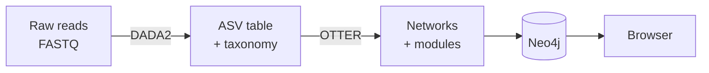

<div align="center">


# MANTA

**M**arine **A**mplicon **N**etwork **T**ime-series **A**nalysis

Explore marine amplicon time series as maps, networks and seasonal cycles, on your own machine,
in your browser.

<p>
  <a href="LICENSE"></a>
  <a href="https://docs.docker.com/compose/"></a>
  
</p>

[Features](#features) ·
[Installation](#installation) ·
[Importing data](#importing-data) ·
[Updating](#updating) ·
[Troubleshooting](#troubleshooting) ·
[Citing](#citing-manta) ·
[Sources and licenses](#sources-and-licenses)

<br>


</div>

<br>

MANTA is for marine ecologists who sample the same place repeatedly and sequence a marker gene
(16S or 18S) each time. It shows where the samples were taken, which organisms occur together,
and when in the year they appear.

MANTA adds no new methods. It runs established ones, **DADA2** for ASVs and **OTTER** for the
networks, stores every result in a database and shows it in the browser. Every number on screen
comes from a stored run or is computed directly from it (e.g. a monthly mean or the day length at
the site).



## Features

<table>
<tr>
<td width="33%" valign="top"><b>World map</b> of all datasets with water depth (GEBCO).<br></td>
<td width="33%" valign="top"><b>ASV pages:</b> taxonomy, abundance over time next to any measured variable, closest network neighbors.<br></td>
<td width="33%" valign="top"><b>Year wheel:</b> when each module peaks, against daylight and a measured variable.<br></td>
</tr>
</table>

- **Networks:** co-occurrence and directed links (convergent cross mapping), grouped into
  modules. ASVs with high closeness within their module are marked (keystone criterion 2 of
  Oldenburg et al. 2024); that alone does not make them keystones.
- **Filters** by module, taxon, function and criterion 2; dataset and filters are kept in the link.
- **Comparison** of ASVs, modules and environmental variables over the year.
- **Import in the browser**, from raw reads or finished results.
- **Assistant (optional):** answers only from the stored results and marks unsupported numbers
  with `[no evidence]`. Its read-only tools also work in any MCP client
  (`apps/manta_mcp/start_mcp.sh`).

Screenshots: HAUSGARTEN F4 example dataset from OTTER (not part of this repository).

## Installation

| | Requirements |
|---|---|
| Step 1 (view data) | [Docker](https://docs.docker.com/get-started/get-docker/) with Compose, [Git](https://git-scm.com/downloads), 4 GB RAM, 10 GB disk |
| Step 2 (import data) | additionally [uv](https://docs.astral.sh/uv/getting-started/installation/), [Node.js](https://nodejs.org/) 22+, `curl`, `unzip` |
| With assistant | 8 GB RAM (small model; more for the default), 20 GB disk |

macOS and Linux work directly. Windows needs WSL 2, which gets only half the RAM by default:
plan 8 GB (16 GB with the assistant) and see the box below.

<details>
<summary><b>Windows: set up WSL 2 first</b></summary>

<br>

1. **Virtualization on?** Task Manager → Performance → CPU → *Virtualization: Enabled*. If not,
   enable Intel VT-x / AMD SVM in the firmware ([instructions](https://support.microsoft.com/en-us/windows/enable-virtualization-on-windows-c5578302-6e43-4b4b-a449-8ced115f58e1)).
2. **Install WSL 2:** PowerShell **as administrator** → `wsl --install` → restart the PC → open
   **Ubuntu** from the Start menu and choose a user name and password (typing stays invisible).
3. **Memory:** in PowerShell, `notepad "$env:USERPROFILE\.wslconfig"`, answer *Yes*, write
   `[wsl2]` and `memory=5GB` on two lines (8 GB PC; 16 GB with assistant: `memory=12GB`; 16 GB
   without assistant: no file needed). Save, then `wsl --shutdown`.
4. **Docker Desktop:** install, start, accept the terms (no sign-in needed). *Settings →
   Resources → WSL integration* → switch on **Ubuntu** → *Apply & restart*. In Ubuntu,
   `docker compose version` must print a version.
5. **Tools for step 2**, in Ubuntu (`sudo` asks for your Linux password):
   ```bash
   sudo apt update && sudo apt install -y curl git unzip
   curl -LsSf https://astral.sh/uv/install.sh | sh
   curl -fsSL https://deb.nodesource.com/setup_22.x | sudo -E bash - && sudo apt install -y nodejs
   export PATH="$HOME/.local/bin:$PATH"
   ```

Run every MANTA command in the **Ubuntu** window, not PowerShell or Git for Windows. Keep the
clone in `~/manta`: on the Windows drive (`C:\`, `/mnt/c`) it fails, because OTTER has a file
named `con.py`, which Windows forbids. When pasting several lines, choose *Paste anyway*.

</details>

### Step 1 — Start MANTA

```bash
git clone https://github.com/benblumbach-eng/manta.git ~/manta
cd ~/manta/deploy
cp .env.example .env
nano .env        # replace change-me in NEO4J_PASSWORD (8+ characters: letters, digits, - and _)
docker compose up -d --build
docker compose exec api python manage.py adduser alice --role admin   # asks for a password
```

Set the password **before** the first start; the database keeps the first one. (In nano: Ctrl+O,
Enter saves, Ctrl+X quits.) Open <http://localhost:8080> and sign in. MANTA starts empty.

| In `~/manta/deploy` | Effect |
|---|---|
| `docker compose stop` / `start` | pause / resume |
| `docker compose down` | remove the containers, keep the data |
| `docker compose down -v` | **also delete** data, accounts and assistant models |

MANTA is only reachable from this machine. Ports 8080, 8443, 7474, 7687 (11434 with the
assistant) can be changed in `deploy/.env`. Neo4j's usage reporting is off.

### Step 2 — Install the import

Every import needs this step, including the example. The lines stop at the first error; running
the block again is safe. Do not use `sudo`.

```bash
cd ~/manta &&
git submodule update --init &&
uv venv --clear --python 3.12 apps/manta_web/backend/.venv &&
uv pip install -p apps/manta_web/backend/.venv/bin/python -r apps/manta_web/backend/requirements.txt &&
([ -f apps/manta_web/backend/.env ] || cp .env.example apps/manta_web/backend/.env) &&
(cd apps/manta_web/frontend && npm ci) &&
uv venv --clear --python 3.10 tools/neo4j_ingest/.venv &&
uv pip install -p tools/neo4j_ingest/.venv/bin/python -r tools/neo4j_ingest/requirements.txt &&
uv venv --clear --python 3.14 tools/dada2_to_otter/.venv &&
uv pip install -p tools/dada2_to_otter/.venv/bin/python -r tools/dada2_to_otter/requirements.txt &&
uv venv --clear --python 3.10 submodules/otter/.venv &&
uv pip install -p submodules/otter/.venv/bin/python -r tools/otter_runner/requirements-otter.txt &&
bash tools/traits/fetch_sources.sh   # trait tables for the function filter (~4 MB, checksummed)
```

Put the same `NEO4J_PASSWORD` as in step 1 into `apps/manta_web/backend/.env` (and adjust
`NEO4J_URI` there if you changed the database port). Then start the import and create its admin
account; the import has its own accounts, separate from step 1:

```bash
cd ~/manta &&
cp apps/manta_web/backend/.env tools/neo4j_ingest/.env &&
bash apps/manta_web/dev.sh start &&
cd apps/manta_web/backend && set -a && . ./.env && set +a &&
.venv/bin/python manage.py adduser alice --role admin
```

The import runs at <http://localhost:5173>; what you import there appears on port 8080 too.
`bash apps/manta_web/dev.sh start|stop|restart|status|logs` (from `~/manta`) controls it;
`stop --db` also stops the database, so port 8080 then shows no data. It uses ports 8000 and 5173
(`MANTA_BACKEND_PORT`, `MANTA_FRONTEND_PORT`). After a reboot, run `dev.sh start` again (on
Windows, start Docker Desktop first).

### Optional

| For | Do |
|---|---|
| Raw reads (FASTQ) | `cd ~/manta && bash tools/dada2_to_otter/install_dada2.sh`: installs R 4.4 ([rig](https://github.com/r-lib/rig)), Bioconductor 3.20 (dada2, Biostrings, ShortRead) and cutadapt 5.2, skipping what exists; asks for your password; 10–30 min on Ubuntu; `--check` only reports. Versions are fixed on purpose: other versions can give different ASVs. |
| Taxon names | a [PR2 file](https://github.com/pr2database/pr2database/releases) in DADA2 format; set `MANTA_PR2=<file>` in `apps/manta_web/backend/.env`, then `bash apps/manta_web/dev.sh restart`. Without it, ASVs stay `unassigned`. |
| Assistant | `cd ~/manta && bash assistant.sh on` downloads `qwen2.5:7b` (4.7 GB); `bash assistant.sh on qwen2.5:1.5b` (1 GB) suits 8 GB machines; any [Ollama model with tool support](https://ollama.com/search?c=tools) works. `status` shows the state, `off` switches it off and keeps the models (`docker volume rm deploy_ollama_models` deletes them). An OpenAI-compatible service works via `MANTA_OPENAI_*` in `deploy/.env`; questions and the values they touch are then sent there. |

**Assistant transcripts:** every conversation is saved to its account, one thread per dataset,
with the full record of each answer (model, every tool call with input and output, evidence
check). Admins can read all transcripts while *Admins can read all transcripts* is on in the
admin panel (default); the chat says so. Keys and passwords are never stored in a transcript.

## Importing data

Every import runs in the browser, with no scripts: open <http://localhost:5173>, sign in as
admin, click **Import a dataset**, select your files, enter a name and the marker (16S or 18S),
optionally a latitude and longitude for the map, and click **Start import**.

| You have | Files | MANTA runs |
|---|---|---|
| Raw reads | paired `<sample>_S<n>_L001_R1_001.fastq.gz` / `…_R2_001.fastq.gz`, optionally `metadata.csv` | DADA2 → OTTER → database |
| DADA2 output | abundance table, taxonomy, ASV sequences, optionally read tracking and `metadata.csv`; as `.Rdata`, `.csv` or `.fa`/`.fasta`. Or the three tables `abundance.csv`, `taxa_info.csv`, `environment_info.csv`. | OTTER → database |
| OTTER output | OTTER's network tables with `abundance.csv`, `environment_info.csv` (and `manta_manifest.json`, if present) | database only |

- **Files as they are.** MANTA recognizes them by content (only the extension matters), maps PR2
  taxonomies (Division → Phylum), fixes shifted taxonomy columns and drops taxonomy rows without
  abundance and samples without reads. The import card lists every change.
- **Dates** come from sample names such as `2016.08.01` or from `metadata.csv` (`;`-separated,
  columns `sample` and `date` as `YYYY-MM-DD`, further columns are environmental variables).
  Without dates, samples only have an order and there is no year wheel.
- **Read tracking** is optional; if present, MANTA checks that each sample kept enough reads.
- **At least 8 samples.** MANTA checks the memory before the run and says if it will not suffice.
- **Duration:** minutes to hours, mostly OTTER's permutation test; it keeps running when you
  leave the page. DADA2 can take hours and much memory; on an 8 GB machine, run it beforehand
  and import its output.
- **At the end**, taxon names are looked up in published trait tables (the function filter, a
  property of the name, not a measurement) and, with dates, measured variables are linked to the
  ASVs. Recomputing a network in the interface creates a new dataset.

**Try it:** `examples/synthetic_12_samples` holds made-up DADA2 output (50 ASVs, 12 samples;
`synthetic_96_samples` has 96). Import all five files (on Windows:
`\\wsl.localhost\Ubuntu\home\<you>\manta\examples\synthetic_12_samples`) as `example_12` with
marker **18S** (`_prok` in the file names is just the DADA2 script's naming), e.g. at 79.0 / 4.17.
It takes 15–40 minutes. The function filter stays empty, because the taxon names are made up.

## Updating

```bash
cd ~/manta && bash update.sh
```

Fetches the latest version, installs only what changed and restarts what this clone runs.
Imported data are kept. **Not during an import:** the restart stops it. Docker must be running.
Local changes stop the update instead of being overwritten. `bash update.sh --check` only
reports (exit code `10` = update available, `0` = none, `1` = error).

<details>
<summary><b>Clones made before October 2026</b> (<code>update.sh</code> repeats the same update, or says <code>Not possible to fast-forward</code>, <code>divergent branches</code> or <code>unrelated histories</code>)</summary>

<br>

The published history was rewritten then. Clone again and take your settings along; the data stay:

```bash
(cd ~/manta && bash apps/manta_web/dev.sh stop)   # only if you use step 2
mv ~/manta ~/manta-old &&
git clone https://github.com/benblumbach-eng/manta.git ~/manta &&
cp ~/manta-old/deploy/.env ~/manta/deploy/ &&
cd ~/manta/deploy && docker compose up -d --build
```

With step 2: run its install block, copy `apps/manta_web/backend/.env` and
`apps/manta_web/backend/manta_auth.db` (the import accounts) from `~/manta-old`, and run the start
block. Then delete `~/manta-old`.

</details>

**Backup:** `bash deploy/backup.sh` saves the step 1 database and accounts to `deploy/backups/`
(MANTA pauses for about 20 s); `bash deploy/restore.sh <neo4j-*.dump> [auth-*.db]` restores
them. Both explain their options with `--help`.

## Troubleshooting

| Message | Fix |
|---|---|
| `invalid path 'lutra/con.py'` or `dubious ownership` | Clone is on the Windows drive; clone into `~/manta` in Ubuntu. |
| `Token "&&" … not a valid statement separator` | You are in PowerShell; use Ubuntu. |
| `could not be found in this WSL 2 distro` / `Cannot connect to the Docker daemon` | Start Docker Desktop; turn on its WSL integration for Ubuntu. |
| `ports are not available … forbidden by its access permissions` | Windows reserved the port (`netsh interface ipv4 show excludedportrange protocol=tcp`); set a free one in `deploy/.env` (for `NEO4J_PORT_BOLT` also `NEO4J_URI`). |
| `localhost` silent after sleep (Windows) | `wsl --shutdown`, restart Docker Desktop, then `cd ~/manta && bash apps/manta_web/dev.sh start`. |
| `uv: command not found` | `export PATH="$HOME/.local/bin:$PATH"`, or install uv in Ubuntu. |
| `EACCES: permission denied … node_modules` | npm once ran with `sudo`: `sudo chown -R $USER:$USER ~/manta`. |
| `permission denied … docker.sock` | `sudo usermod -aG docker $USER`, then log in again (or `newgrp docker`; WSL: `wsl --shutdown`). |
| Neo4j `is unhealthy` / `dependency failed to start` | `docker compose logs neo4j`; if the password is too short, set 8+ characters and `docker compose up -d`. |
| `Security.Unauthorized` | Password mismatch. Without data: `docker compose down -v && docker compose up -d`, recreate the account. Step 2: `apps/manta_web/backend/.env` and `tools/neo4j_ingest/.env` need the password from `deploy/.env`. |
| `Failed to fetch` | Backend not reachable: `bash apps/manta_web/dev.sh status`. |
| Step 1 account rejected on port 5173 | The import has its own accounts (step 2). |
| `Not possible to fast-forward` and similar | Clone too old; see [Updating](#updating). |
| `already exists and is not an empty directory` during an update | Run `bash update.sh` again; it finishes the interrupted update. |

Anything else: open an [issue](https://github.com/benblumbach-eng/manta/issues) with what you did,
what you saw and the output of `bash apps/manta_web/dev.sh logs` (step 2) or
`docker compose logs api` (step 1). Security problems: **Report a vulnerability** in the
**Security** tab. This repository is generated from the development version, so pull requests
cannot be merged; describe changes in an issue.

## Citing MANTA

Use **Cite this repository** in the GitHub sidebar ([`CITATION.cff`](CITATION.cff)). MANTA runs
existing methods, so please also cite DADA2, OTTER, cutadapt, PR2 and the annotation sources below.

## Sources and licenses

MANTA's code is under the [MIT License](LICENSE). Third-party software and data keep their own
licenses; except for the bathymetry file, none is copied here, MANTA downloads them from their
sources.

**Software**

- **OTTER** — Kronberg & Oldenburg, QTB, HHU Düsseldorf; MIT; Git submodule. Cite the software
  ([doi:10.5281/zenodo.13840702](https://doi.org/10.5281/zenodo.13840702), all versions) and
  Oldenburg et al. 2024. <https://gitlab.com/qtb-hhu/marine/otter>
- **DADA2** — Callahan et al. 2016, *Nat Methods* 13:581, [doi:10.1038/nmeth.3869](https://doi.org/10.1038/nmeth.3869); LGPL-2.
  MANTA's script follows the [DADA2 tutorial](https://benjjneb.github.io/dada2/tutorial.html); filter and primer
  defaults follow QTB's [fastq2abundance](https://gitlab.com/qtb-hhu/marine/publications/fastq2abundance)
  (Ellen Oldenburg; linked, not included).
- **cutadapt** — Martin 2011, *EMBnet.journal* 17:10, [doi:10.14806/ej.17.1.200](https://doi.org/10.14806/ej.17.1.200); MIT.
- **Neo4j** Community Edition 5.26 (GPL v3), **Caddy** (Apache-2.0, web server) and **Ollama**
  (MIT, language models): unchanged Docker images from Docker Hub.
- **pyreadr** (AGPL-3.0, reads `.Rdata`): installed into its own environment by step 2, not distributed.
- **Language models** — Qwen 2.5 (Alibaba Cloud; Apache 2.0 except the 3B and 72B sizes, which
  have their own licenses); Llama 3.1 (Meta; Llama 3.1 Community License).
- Other packages: `requirements*.txt` and `apps/manta_web/frontend/package.json`.

**Data**

- **Bathymetry** — `apps/manta_web/frontend/public/bathymetry.json`, simplified from the
  [GEBCO_2020 Grid](https://www.gebco.net/) (GEBCO Compilation Group 2020,
  [doi:10.5285/a29c5465-b138-234d-e053-6c86abc040b9](https://doi.org/10.5285/a29c5465-b138-234d-e053-6c86abc040b9));
  public domain; not for navigation.
- **Taxonomy** — PR2, Guillou et al. 2013, *Nucleic Acids Res* 41:D597, [doi:10.1093/nar/gks1160](https://doi.org/10.1093/nar/gks1160); MIT; downloaded by the user.
- **Function annotation** — 18S: Mixoplankton Database as in PR2 v5.1.0 (Mitra et al. 2023,
  *J Eukaryot Microbiol* 70:e12972, [doi:10.1111/jeu.12972](https://doi.org/10.1111/jeu.12972)), PR2 v5.1.0's
  function column, Trophic Mode Database v1.1 (Jones et al. 2025, [doi:10.5281/zenodo.15149453](https://doi.org/10.5281/zenodo.15149453), CC BY 4.0).
  16S: FAPROTAX 1.2.12 (Louca et al. 2016, *Science* 353:1272, [doi:10.1126/science.aaf4507](https://doi.org/10.1126/science.aaf4507); own license, included in the download).
  Downloads are checked against fixed checksums.
- **Screenshots** — HAUSGARTEN F4 from OTTER's test data; Oldenburg et al. 2024, *Commun Earth
  Environ* 5:643, [doi:10.1038/s43247-024-01782-0](https://doi.org/10.1038/s43247-024-01782-0).
- **Example datasets** — synthetic, made for MANTA; MIT.

**Methods**

- Network terms — Oldenburg et al. 2024.
- Recurrence and module timing (peak window, annual oscillation, year-to-year variability) —
  Priest et al. 2025, *Nat Commun* 16:1326, [doi:10.1038/s41467-025-56203-3](https://doi.org/10.1038/s41467-025-56203-3).
- Keystone criterion 2, "a high centrality (closeness) value within its co-occurrence community"
  (Oldenburg et al. 2024, Methods). MANTA computes it on the undirected co-occurrence network:
  unweighted closeness (n − 1)/Σd within each module's subgraph; per ASV a one-sided t-test of
  the module's values against its own (`scipy.stats.ttest_1samp(…, popmean=c_i, alternative='less')`);
  Benjamini–Hochberg over all testable network ASVs, q ≤ 0.05. A selection step, not a keystone:
  criteria 1 and 3 are not tested.

<br>

<div align="center">
<sub>Bachelor's thesis · Quantitative and Theoretical Biology · Heinrich Heine University Düsseldorf</sub>
</div>
