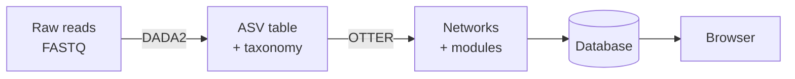

<div align="center">


# MANTA

**M**arine **A**mplicon **N**etwork **T**ime-series **A**nalysis

See which marine organisms occur together, and when in the year, in your browser.

<p>
  <a href="LICENSE"></a>
  <a href="https://docs.docker.com/compose/"></a>
  
</p>

[Features](#features) ·
[Installation](#installation) ·
[Importing data](#importing-data) ·
[Updating](#updating) ·
[Troubleshooting](#troubleshooting) ·
[Citing](#citing-manta) ·
[Sources and licenses](#sources-and-licenses)

<br>


</div>

<br>

MANTA is for amplicon time series: samples taken at the same place again and again, each
sequenced for a marker gene (16S or 18S). It turns these sequences into explorable networks and
shows where the samples come from, which organisms occur together, and in which season they
peak.

MANTA builds on two established tools and runs them for you:



- **DADA2** turns raw sequencing reads into **ASVs** (amplicon sequence variants): exact DNA
  sequences with a count per sample. Several ASVs can belong to the same organism.
- **OTTER** finds which ASVs rise and fall together and groups them into **modules**.

MANTA saves every result in a database and shows it in the browser. Every number comes
from one of these runs or is calculated directly from it, such as a monthly mean or the day
length at the sampling site.

## Features

<table>
<tr>
<td width="33%" valign="top"><b>A world map</b> with all your datasets.<br></td>
<td width="33%" valign="top"><b>A page per ASV</b> with its taxon name, its abundance over time and its closest partners.<br></td>
<td width="33%" valign="top"><b>A year wheel</b> that shows when each module peaks.<br></td>
</tr>
</table>

You can also:

- see the co-occurrence network: a line joins two ASVs whose abundances rise and fall together,
  and an arrow shows that one ASV significantly influences the other (convergent cross mapping,
  CCM);
- mark possible keystone ASVs (✦) by choosing the keystone criteria of Oldenburg et al. 2024 in
  the sidebar: 1, a significant CCM link; 2, an unusually high closeness within its module.
  The third criterion (a stable state from ELA) is not available, so a marked ASV is a
  candidate, not a proven keystone;
- filter by module or taxon name, and share the exact view as a link;
- compare ASVs, modules and measurements over the year;
- ask an optional chat assistant, which answers only from your stored results and marks any
  number it cannot back up with `[no evidence]`. Its tools also work in other AI apps that
  support MCP (`apps/manta_mcp/start_mcp.sh`).

The screenshots show the made-up example dataset `examples/synthetic_12_samples`.

## Installation

Installation has two steps. Step 1 starts MANTA so you can look at data. Step 2 installs the
analysis tools (OTTER as a Git submodule, plus the Python environments that prepare its input
and save its results) and the import page in the browser. You need step 2 for every dataset,
including the example.

You need [Docker](https://docs.docker.com/get-started/get-docker/) with Compose and
[Git](https://git-scm.com/downloads). For step 2 you also need
[uv](https://docs.astral.sh/uv/getting-started/installation/), [Node.js](https://nodejs.org/) 22
or newer, `curl` and `unzip`. Your computer needs at least 4 GB of memory and 10 GB of free disk
space, or 8 GB of memory and 20 GB of disk if you want the chat assistant.

MANTA runs on macOS and Linux. On Windows, first set up WSL 2 as described in the next section.

### Windows only: set up WSL 2

WSL 2 runs Linux inside Windows. It only gets half of your memory, so plan for 8 GB (16 GB with
the assistant).

1. Open the Task Manager, go to Performance and then CPU, and check that it says
   *Virtualization: Enabled*. If it says *Disabled*, switch it on in your PC's firmware settings
   ([how to do this](https://support.microsoft.com/en-us/windows/enable-virtualization-on-windows-c5578302-6e43-4b4b-a449-8ced115f58e1)).
2. Open PowerShell as administrator, run `wsl --install` and restart the PC. Then open
   **Ubuntu** from the Start menu and choose a user name and password. The password stays
   invisible while you type.
3. In PowerShell, run `notepad "$env:USERPROFILE\.wslconfig"`, answer *Yes*, and write these
   two lines:
   ```
   [wsl2]
   memory=5GB
   ```
   That is for a PC with 8 GB. With 16 GB and the assistant, write `memory=12GB`. With 16 GB
   and no assistant, skip this step. Save the file and run `wsl --shutdown`.
4. Install Docker Desktop, start it and accept the terms. You don't need to sign in. In its
   settings, go to Resources and then WSL integration, switch on **Ubuntu** and click
   **Apply & restart**. To check, run `docker compose version` in Ubuntu; it should print a
   version number.
5. In Ubuntu, install the tools for step 2. `sudo` asks for your Linux password.
   ```bash
   sudo apt update && sudo apt install -y curl git unzip
   curl -LsSf https://astral.sh/uv/install.sh | sh
   curl -fsSL https://deb.nodesource.com/setup_22.x | sudo -E bash - && sudo apt install -y nodejs
   export PATH="$HOME/.local/bin:$PATH"
   ```

From now on, type every command in the Ubuntu window, not in PowerShell. Keep MANTA in
`~/manta` inside Ubuntu. It does not work on the Windows drive (`C:\`), because OTTER contains a
file named `con.py`, a name Windows forbids. If Windows asks before pasting several lines, choose
**Paste anyway**.

### Step 1: Start MANTA

1. Download MANTA and open its settings file:
   ```bash
   git clone https://github.com/benblumbach-eng/manta.git ~/manta
   cd ~/manta/deploy
   cp .env.example .env
   nano .env
   ```
2. In the line `NEO4J_PASSWORD=change-me`, replace `change-me` with a password for the
   database. Use at least 8 characters, and only letters, digits, `-` and `_`. Save with
   Ctrl+O and Enter, and close with Ctrl+X. Do this before the first start, because the
   database keeps the first password it gets.
3. Start MANTA and create your account. The second command asks you to choose a password.
   ```bash
   docker compose up -d --build
   docker compose exec api python manage.py adduser alice --role admin
   ```
4. Open <http://localhost:8080> and sign in. MANTA is still empty; step 2 adds data.

Only this computer can reach MANTA. To pause it, run `docker compose stop` in `~/manta/deploy`,
and `docker compose start` to resume. `docker compose down` removes MANTA's containers but keeps
your data. Be careful with `docker compose down -v`: it deletes all data, accounts and assistant
models.

MANTA uses the ports 8080, 8443, 7474 and 7687 (and 11434 for the assistant). If one is taken,
change it in `deploy/.env`. The database's usage reporting is switched off.

### Step 2: Install the analysis tools and the import

1. Install the analysis tools. This takes a while. If a line fails, the block stops; fix the
   problem and run the whole block again. Don't use `sudo` here.
   ```bash
   cd ~/manta &&
   git submodule update --init &&
   uv venv --clear --python 3.12 apps/manta_web/backend/.venv &&
   uv pip install -p apps/manta_web/backend/.venv/bin/python -r apps/manta_web/backend/requirements.txt &&
   ([ -f apps/manta_web/backend/.env ] || cp .env.example apps/manta_web/backend/.env) &&
   (cd apps/manta_web/frontend && npm ci) &&
   uv venv --clear --python 3.10 tools/neo4j_ingest/.venv &&
   uv pip install -p tools/neo4j_ingest/.venv/bin/python -r tools/neo4j_ingest/requirements.txt &&
   uv venv --clear --python 3.14 tools/dada2_to_otter/.venv &&
   uv pip install -p tools/dada2_to_otter/.venv/bin/python -r tools/dada2_to_otter/requirements.txt &&
   uv venv --clear --python 3.10 submodules/otter/.venv &&
   uv pip install -p submodules/otter/.venv/bin/python -r tools/otter_runner/requirements-otter.txt
   ```
2. Open `apps/manta_web/backend/.env` with `nano` and enter the same `NEO4J_PASSWORD` as in
   step 1. If you changed the database port in step 1, change `NEO4J_URI` here too.
3. Start the import and create an account for it. The import has its own accounts, separate
   from step 1.
   ```bash
   cd ~/manta &&
   cp apps/manta_web/backend/.env tools/neo4j_ingest/.env &&
   bash apps/manta_web/dev.sh start &&
   cd apps/manta_web/backend && set -a && . ./.env && set +a &&
   .venv/bin/python manage.py adduser alice --role admin
   ```
4. Open <http://localhost:5173>. This is where you import data. Everything you import here
   also appears at <http://localhost:8080>.

After restarting your computer, run `cd ~/manta && bash apps/manta_web/dev.sh start` again (on
Windows, start Docker Desktop first). Besides `start`, the script knows `stop`, `restart`,
`status` and `logs`. `stop --db` also stops the database, so
<http://localhost:8080> then shows no data. The import uses the ports 8000 and 5173; to change
them, set `MANTA_BACKEND_PORT` and `MANTA_FRONTEND_PORT`.

### Optional: raw reads, taxonomy for raw reads, chat assistant

**Raw sequencing reads (FASTQ).** To import raw reads, install DADA2:

```bash
cd ~/manta && bash tools/dada2_to_otter/install_dada2.sh
```

This installs R 4.4 (with [rig](https://github.com/r-lib/rig)), Bioconductor 3.20 with dada2,
Biostrings and ShortRead, and cutadapt 5.2. It skips what you already have and asks for your
password before installing R. On Ubuntu it takes 10 to 30 minutes. With `--check` it only shows
what is missing. The versions are fixed on purpose, because other versions can turn the same
reads into different ASVs.

**Taxonomy for raw reads.** PR2 is a reference database of known 18S rRNA sequences, mostly
from protists (single-celled eukaryotes). When MANTA runs DADA2 on raw reads, DADA2 compares each
ASV with this reference and assigns it a taxon name (from kingdom down to species, as far as the
match allows). For 16S data, a SILVA reference in the same DADA2 format works too. You only need
a reference for raw reads; if you import DADA2 results, your taxonomy table already has the
names. Download the PR2 file in DADA2 format from the
[PR2 releases](https://github.com/pr2database/pr2database/releases), set
`MANTA_PR2=<path to the file>` in `apps/manta_web/backend/.env` and run
`bash apps/manta_web/dev.sh restart`. Without it, the import still works, but ASVs from raw reads
stay `unassigned`.

**Chat assistant.** Switch it on with:

```bash
cd ~/manta && bash assistant.sh on
```

This downloads the language model `qwen3:8b` (5.2 GB). On a computer with 8 GB of memory, use
the smaller `bash assistant.sh on qwen2.5:1.5b` (1 GB). Any
[Ollama model with tool support](https://ollama.com/search?c=tools) works.
`bash assistant.sh status` shows what is running, and `bash assistant.sh off` switches the
assistant off but keeps the models. `docker volume rm deploy_ollama_models` deletes them.
Instead of a local model you can use an OpenAI-compatible service with the `MANTA_OPENAI_*`
settings in `deploy/.env`. Your questions and the values they touch are then sent to that
service.

Anyone with a key for a stronger model connects it for their own account under **⚙ settings →
Own model** (address, model, API key). The key is stored encrypted with the account; it then
appears in the chat's model menu.

Each conversation is saved to the account that had it, one thread per dataset, with a full
record of how each answer came about: the model, every tool it used with input and output, and
the evidence check. Admins read all conversations under **admin → Transcripts**; the chat tells
users so. Keys and passwords never appear in a transcript.

## Importing data

You import everything in the browser. You don't need any scripts, and you don't need to prepare
your files.

1. Open <http://localhost:5173> and sign in with your import account.
2. Click **Import a dataset** and select your files.
3. Give the dataset a name and choose the marker gene, 16S or 18S. To show the dataset on the
   map, also enter a latitude and longitude.
4. Click **Start import**.

A card shows the progress. You can close the page; the import keeps running. It takes minutes
to hours; most of that time goes to OTTER. When it is done, the dataset appears in the list.

### Which files you can import

- **Raw reads:** paired `.fastq.gz` files, named like `<sample>_S<n>_L001_R1_001.fastq.gz` and
  `…_R2_001.fastq.gz`. MANTA runs DADA2 and then OTTER. This needs DADA2 from the optional
  section above.
- **DADA2 results:** an abundance table, a taxonomy table and the ASV sequences, as `.Rdata`,
  `.csv` or `.fa`/`.fasta` files. You can also use OTTER's input tables `abundance.csv`,
  `taxa_info.csv` and `environment_info.csv`. MANTA runs OTTER.
- **OTTER results:** OTTER's network tables, plus `abundance.csv` and `environment_info.csv`
  (and `manta_manifest.json`, if you have it). MANTA only saves them.

MANTA recognizes each file by its content, so file names don't matter, only the ending. It also
fixes common problems on its own: taxonomy rows for ASVs that are not in the abundance table,
samples without reads, and taxonomy columns that are shifted by one. PR2 names are mapped
(Division becomes Phylum). The import card lists every change.

### Good to know

For the year wheel, MANTA needs the date of each sample. It reads it from sample names that are
dates, such as `2016.08.01`. Otherwise add a `metadata.csv`, separated by `;`, with the columns
`sample` and `date` (`YYYY-MM-DD`). Any further columns, such as temperature, become
measurements. Without dates, MANTA only knows the order of the samples and shows no year wheel.

Read tracking (DADA2's table of how many reads each sample kept) is optional. If you add it,
MANTA checks that no sample lost too many reads.

A dataset needs at least 8 samples. Before OTTER starts, MANTA checks whether your computer has
enough memory. DADA2 can take hours and needs a lot of memory; on a computer with 8 GB, run
DADA2 elsewhere and import its results.

At the end, if there are dates, MANTA links the measurements to the ASVs.

If you recalculate a network in MANTA, it creates a new dataset and leaves the original as it is.

### Try it with the example

`examples/synthetic_12_samples` contains made-up DADA2 results: 50 ASVs in 12 samples, with
dates and measurements. `examples/synthetic_96_samples` is the same with 96 samples.

1. In the import, select all five files from `~/manta/examples/synthetic_12_samples`. On Windows
   they are at `\\wsl.localhost\Ubuntu\home\<your user name>\manta\examples\synthetic_12_samples`.
2. Name the dataset `example_12` and choose 18S. The names are eukaryotic; ignore the `_prok` in
   the file names. As position, try 79.0 and 4.17.
3. Click **Start import** and wait 15 to 40 minutes.

You then see a network with modules, a page per ASV and a year wheel.

## Updating

```bash
cd ~/manta && bash update.sh
```

This downloads the newest version, installs only what changed and restarts MANTA. Your data
stay. Docker must be running.

**Don't update while an import is running.** The update restarts the import page, which stops
a running import.

If you changed files in `~/manta` yourself, the update stops instead of overwriting them.
`bash update.sh --check` only tells you whether an update exists (exit code `10` means yes, `0`
no, `1` an error).

### If your copy is from before October 2026

The project's history was rewritten in October 2026. Older copies can't update: `update.sh`
repeats the same update or stops with `Not possible to fast-forward`, `divergent branches` or
`unrelated histories`. Make a fresh copy; your data stay where they are.

```bash
(cd ~/manta && bash apps/manta_web/dev.sh stop)   # only if you did step 2
mv ~/manta ~/manta-old &&
git clone https://github.com/benblumbach-eng/manta.git ~/manta &&
cp ~/manta-old/deploy/.env ~/manta/deploy/ &&
cd ~/manta/deploy && docker compose up -d --build
```

If you did step 2, run its install block again, copy `apps/manta_web/backend/.env` and
`apps/manta_web/backend/manta_auth.db` (the import accounts) from `~/manta-old` to the same place
in `~/manta`, and start the import as in step 2. When everything works, delete `~/manta-old`.

### Backup

`bash deploy/backup.sh` saves the database and the accounts from step 1 to `deploy/backups/`.
MANTA pauses for about 20 seconds while it runs. To restore, run
`bash deploy/restore.sh <neo4j-*.dump> [auth-*.db]`. Both explain their options with `--help`.

## Troubleshooting

**`invalid path 'lutra/con.py'` or `dubious ownership`.** MANTA is on the Windows drive.
Download it again into `~/manta` inside Ubuntu.

**`Token "&&" … not a valid statement separator`.** You are in PowerShell. Use the Ubuntu
window.

**`could not be found in this WSL 2 distro` or `Cannot connect to the Docker daemon`.** Docker
isn't running. Start Docker Desktop and check that its WSL integration for Ubuntu is on.

**`ports are not available` … `forbidden by its access permissions`.** Windows has reserved that
port. In PowerShell, `netsh interface ipv4 show excludedportrange protocol=tcp` lists the
reserved ones. Pick a free port in `deploy/.env`; for `NEO4J_PORT_BOLT`, also change `NEO4J_URI`
from step 2.

**`localhost` doesn't answer after the PC was asleep (Windows).** Run `wsl --shutdown` in
PowerShell, restart Docker Desktop, then run `cd ~/manta && bash apps/manta_web/dev.sh start` in
Ubuntu.

**`uv: command not found`.** Run `export PATH="$HOME/.local/bin:$PATH"`, or install uv inside
Ubuntu.

**`EACCES: permission denied … node_modules`.** npm once ran with `sudo`. Run
`sudo chown -R $USER:$USER ~/manta`.

**`permission denied … docker.sock`.** Run `sudo usermod -aG docker $USER`, then log out and in
again (or run `newgrp docker`). On Windows, run `wsl --shutdown` and reopen Ubuntu.

**Neo4j `is unhealthy` or `dependency failed to start`.** Run `docker compose logs neo4j`. If the
password is too short, choose one with at least 8 characters and run `docker compose up -d`.

**`Security.Unauthorized`.** The passwords don't match. `deploy/.env`,
`apps/manta_web/backend/.env` and `tools/neo4j_ingest/.env` need the same `NEO4J_PASSWORD`. The
database keeps its first password; if it holds no data yet, reset it in `~/manta/deploy` with
`docker compose down -v` and `docker compose up -d`, then create your account again.

**`Failed to fetch` in the browser.** The import isn't running. `bash apps/manta_web/dev.sh status`
shows why.

**Your account doesn't work at port 5173.** The import has its own accounts. Create one as in
step 2.

**`Not possible to fast-forward`, `divergent branches` or `unrelated histories`.** Your copy is
too old. See [Updating](#if-your-copy-is-from-before-october-2026).

**`already exists and is not an empty directory` during an update.** Run `bash update.sh` again.
It finishes the interrupted update.

Still stuck? Open an [issue](https://github.com/benblumbach-eng/manta/issues) and describe what
you did and what you saw. Add the output of `bash apps/manta_web/dev.sh logs` (import) or
`docker compose logs api` (step 1). Report security problems privately via **Report a
vulnerability** in the **Security** tab. This repository is copied from the development version,
so pull requests can't be merged; describe changes in an issue instead.

## Citing MANTA

Click **Cite this repository** on the right of the GitHub page (it uses
[`CITATION.cff`](CITATION.cff)). Because MANTA runs other people's methods, also cite DADA2,
OTTER, cutadapt and PR2.

## Sources and licenses

MANTA's own code is under the [MIT License](LICENSE). Other software and data keep their own
licenses. Apart from the bathymetry file, none of them is copied into this repository; MANTA
downloads them from their original sources.

**Software**

- **OTTER** — Kronberg & Oldenburg, QTB, Heinrich Heine University Düsseldorf; MIT License.
  Included as a Git submodule. Cite the software ([doi:10.5281/zenodo.13840702](https://doi.org/10.5281/zenodo.13840702),
  all versions) and Oldenburg et al. 2024 (below). <https://gitlab.com/qtb-hhu/marine/otter>
- **DADA2** — Callahan et al. 2016, *Nat Methods* 13:581, [doi:10.1038/nmeth.3869](https://doi.org/10.1038/nmeth.3869); LGPL-2.
  MANTA's script follows the [DADA2 tutorial](https://benjjneb.github.io/dada2/tutorial.html); its
  filter and primer defaults follow QTB's [fastq2abundance](https://gitlab.com/qtb-hhu/marine/publications/fastq2abundance)
  (Ellen Oldenburg), which is linked, not included.
- **cutadapt** — Martin 2011, *EMBnet.journal* 17:10, [doi:10.14806/ej.17.1.200](https://doi.org/10.14806/ej.17.1.200); MIT License.
- **Neo4j** Community Edition 5.26 (GPL v3), run unchanged as a separate Docker container.
- **Caddy** (Apache-2.0) serves the web pages and **Ollama** (MIT) runs the language models;
  both are unchanged Docker images from Docker Hub.
- **pyreadr** (AGPL-3.0) reads `.Rdata` files. Step 2 installs it into its own environment; it
  is not distributed with MANTA.
- **Language models** — Qwen 2.5 (Alibaba Cloud) is Apache 2.0 except the 3B and 72B sizes, which
  have their own licenses. Llama 3.1 (Meta) is under the Llama 3.1 Community License.
- All other Python and JavaScript packages are listed in the `requirements*.txt` files and
  `apps/manta_web/frontend/package.json`, each under its own license.

**Data**

- **Bathymetry** — `apps/manta_web/frontend/public/bathymetry.json` is derived from the
  [GEBCO_2020 Grid](https://www.gebco.net/) (GEBCO Compilation Group 2020,
  [doi:10.5285/a29c5465-b138-234d-e053-6c86abc040b9](https://doi.org/10.5285/a29c5465-b138-234d-e053-6c86abc040b9)),
  public domain. It is simplified and not suitable for navigation.
- **Taxonomy reference** — PR2, Guillou et al. 2013, *Nucleic Acids Res* 41:D597, [doi:10.1093/nar/gks1160](https://doi.org/10.1093/nar/gks1160); MIT License; downloaded by the user.
- **Example datasets and screenshots** — synthetic, made for MANTA; MIT License.

**Methods**

- Network terms — Oldenburg et al. 2024, *Commun Earth Environ* 5:643,
  [doi:10.1038/s43247-024-01782-0](https://doi.org/10.1038/s43247-024-01782-0).
- Seasonal recurrence and modules — Priest et al. 2025, *Nat Commun* 16:1326,
  [doi:10.1038/s41467-025-56203-3](https://doi.org/10.1038/s41467-025-56203-3). The paper measures
  annual oscillation and peak timing per ASV and year-to-year differences per community; MANTA's
  peak window and year-to-year variability per module build on these ideas but are its own.
- Keystone criteria — Oldenburg et al. 2024 (above), Methods "Keystone species definition": (1)
  "a significant influence on other ASV in the network", (2) "a high centrality (closeness)
  value within its co-occurrence community", (3) "presence in at least one stable state as
  predicted by ELA". For criterion 1, MANTA marks every ASV at either end of a link with a
  significant CCM direction. For criterion 2, MANTA works on the undirected co-occurrence
  network: closeness within the module subgraph (all members, all links with both ends in the
  module), unweighted (n − 1)/Σd; per ASV a one-sided one-sample t-test of the module's
  closeness values against its own (`scipy.stats.ttest_1samp(…, popmean=c_i,
  alternative='less')`); Benjamini–Hochberg over all testable network ASVs, q ≤ 0.05. Criterion
  3 is not tested, so marked ASVs are candidates, not keystones.

<br>

<div align="center">
<sub>Bachelor's thesis · Quantitative and Theoretical Biology · Heinrich Heine University Düsseldorf</sub>
</div>
