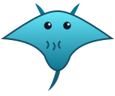
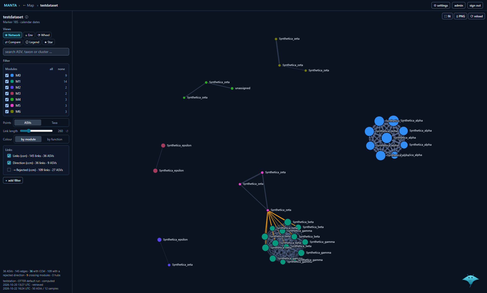
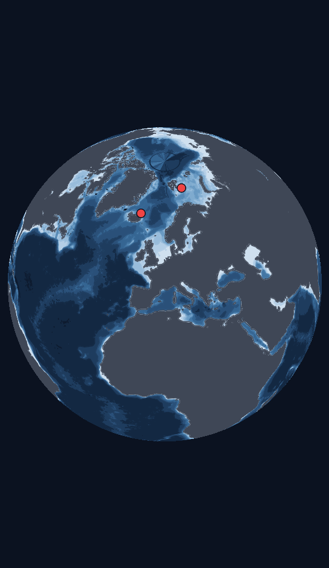
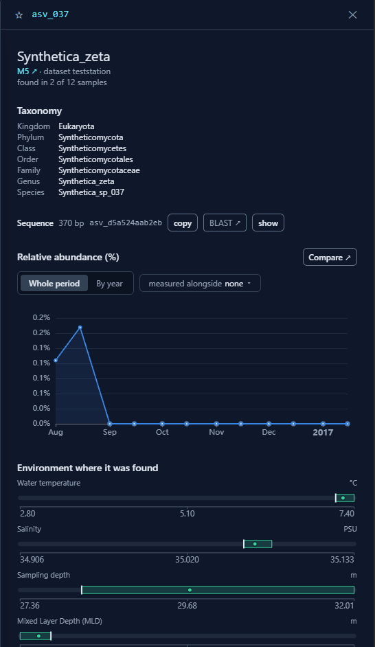
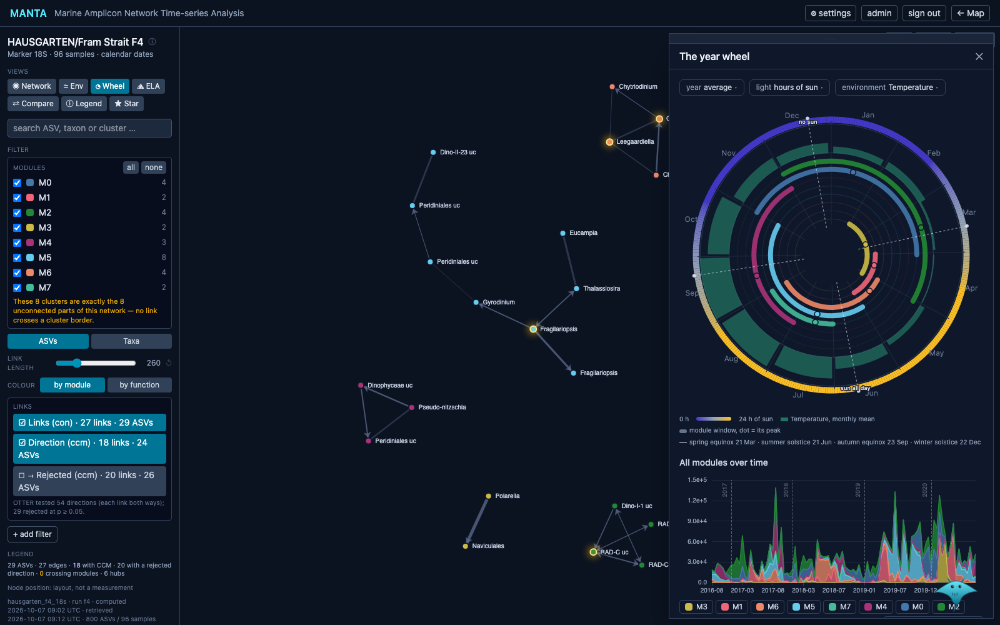
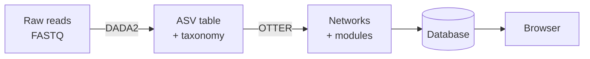

<div align="center">



# MANTA

**M**arine **A**mplicon **N**etwork **T**ime-series **A**nalysis

Explore marine amplicon time series as maps, networks and seasonal cycles — on your own machine,
in your browser.

<p>
  <a href="LICENSE"></a>
  <a href="https://docs.docker.com/compose/"></a>
  
</p>

[Features](#features) ·
[How it works](#how-it-works) ·
[Installation](#installation) ·
[Importing data](#importing-data) ·
[Updating](#updating) ·
[Troubleshooting](#troubleshooting) ·
[Citing](#citing-manta) ·
[Sources and licenses](#sources-and-licenses)

<br>



</div>

<br>

MANTA is for marine ecologists who sample the same place again and again and sequence a marker
gene (16S or 18S) each time. It turns the resulting amplicon sequence variants (ASVs) into an
interactive overview: where the samples were taken, which organisms occur together, and when in
the year they appear.

MANTA does not introduce new methods. It runs established ones — **DADA2** for ASVs and **OTTER**
for the networks — keeps every result in a database, and shows it in the browser. Every number on
screen comes from a stored analysis run or is computed directly from it, such as a monthly mean or
the day length at the sampling site.

## Features

<table>
<tr>
<td width="50%" valign="top">

**World map.** All datasets on a globe with water depth (GEBCO).



</td>
<td width="50%" valign="top">

**ASV pages.** Taxonomy, abundance over time beside any measured variable, and the ASV's closest
neighbors in the network.



</td>
</tr>
<tr>
<td width="50%" valign="top">

**Year wheel.** When each module of co-occurring organisms peaks, set against daylight and a
measured variable.



</td>
<td width="50%" valign="top">

**Also included**

- Co-occurrence networks and directed links (convergent cross mapping), grouped into modules;
  organisms with a high closeness centrality within their module are marked (criterion 2 of the
  keystone definition of Oldenburg et al. 2024, see Methods) — not keystones on their own
- Filters by module, taxon, function and criterion 2; the dataset and filters are kept in the link
- Energy landscape: stable community states and the transitions between them
- Comparison over the year of ASVs, modules and environmental variables within a dataset
- Import in the browser, from raw reads or from finished results
- An optional assistant that answers from the stored results and marks any number it cannot back
  up with `[no evidence]`

</td>
</tr>
</table>

The screenshots show the HAUSGARTEN F4 example dataset that ships with OTTER; it is not part of
this repository.

## How it works



| Step | Tool | Installation |
|---|---|---|
| Reads → ASVs and taxonomy | [DADA2](https://benjjneb.github.io/dada2/) | R, installed separately |
| ASVs → networks and modules | [OTTER](https://gitlab.com/qtb-hhu/marine/otter) | fetched with MANTA |
| Energy landscape (optional) | [rELA](https://github.com/kecosz/rELA) | downloaded on request |
| Storage | [Neo4j](https://neo4j.com/) | runs in Docker |

## Installation

MANTA is installed in two steps. **Step 1** starts the platform. **Step 2** adds the analysis
tools; every import needs it, including the example datasets.

**Requirements:** [Docker](https://docs.docker.com/get-started/get-docker/) with Compose and
[Git](https://git-scm.com/downloads). 4 GB RAM and 10 GB free disk space without the assistant;
with it, 8 GB RAM for the small model (more for the default one) and 20 GB disk. macOS and Linux
work directly; Windows needs WSL 2.

<details>
<summary><b>Windows: set up WSL 2 first</b></summary>

<br>

1. **Check that virtualization is on:** Task Manager → Performance → CPU → *Virtualization:
   Enabled*. If it says *Disabled*, turn it on in the firmware settings (Intel VT-x or AMD SVM);
   Microsoft has [instructions per manufacturer](https://support.microsoft.com/en-us/windows/enable-virtualization-on-windows-c5578302-6e43-4b4b-a449-8ced115f58e1).
2. **Install WSL 2:** open PowerShell **as administrator**, run `wsl --install`, then **restart
   the PC**. On first start, Ubuntu asks for a new Linux user name and password.
3. **Install Docker Desktop** and keep its WSL integration switched on (the default).

From here on, run every command in the **Ubuntu** window, not in PowerShell, and keep the clone
in the Linux home directory (`~/manta`). A clone on the Windows drive (`C:\`, `/mnt/c`) does not
work: OTTER contains a file named `con.py`, which Windows does not allow.

</details>

### Step 1 — Start MANTA

```bash
git clone https://github.com/benblumbach-eng/manta.git ~/manta
cd ~/manta/deploy
cp .env.example .env
```

Choose a password of at least 8 characters and set it as `NEO4J_PASSWORD` in `deploy/.env`
**before** the first start — the database keeps the password it starts with. Then:

```bash
docker compose up -d --build
docker compose exec api python manage.py adduser alice --role admin
```

The second command asks for a password for the new account (at least 8 characters, entered
twice). Open <http://localhost:8080> and sign in. MANTA starts empty; to add data, continue with
step 2.

MANTA is only reachable from this machine. It uses ports 8080, 8443, 7474 and 7687 (and 11434
with the assistant); all can be changed in `deploy/.env`. In `~/manta/deploy`,
`docker compose stop` and `docker compose start` pause and resume MANTA; `docker compose down`
removes the containers but keeps your data, while `docker compose down -v` also deletes the data,
the accounts and any downloaded assistant models. The bundled Neo4j's anonymous usage reporting is
switched off.

**Assistant (optional).** Everything except the chat works without a language model. To add one:

```bash
cd ~/manta && bash assistant.sh on
```

This downloads `qwen2.5:7b` (4.7 GB). A smaller model for 8 GB machines is `bash assistant.sh on
qwen2.5:1.5b` (1 GB); any [Ollama model with tool support](https://ollama.com/search?c=tools)
works. `bash assistant.sh status` shows the state; `bash assistant.sh off` switches it off and
keeps the downloaded models (`docker volume rm deploy_ollama_models` deletes them). An
OpenAI-compatible service can be used instead via the `MANTA_OPENAI_*` settings in `deploy/.env`;
questions and the values they touch are then sent to that service.

Every conversation with the assistant is saved to its account, one thread per dataset, with the
full record of each answer ("How was this answered?": the model, every tool call with its input
and output, and the evidence check). Administrators can read all accounts' transcripts while
*Admins can read all transcripts* is on in the admin panel (the default); the chat says so.
Keys and passwords are never written into a transcript.

### Step 2 — Install the analysis tools

Additional requirements: [uv](https://docs.astral.sh/uv/getting-started/installation/),
[Node.js](https://nodejs.org/) 22 or newer, `curl` and `unzip`.

<details>
<summary><b>Installing these on Ubuntu / WSL</b></summary>

<br>

```bash
sudo apt update && sudo apt install -y curl git unzip
curl -LsSf https://astral.sh/uv/install.sh | sh
curl -fsSL https://deb.nodesource.com/setup_22.x | sudo -E bash - && sudo apt install -y nodejs
export PATH="$HOME/.local/bin:$PATH"
```

On Windows, install them inside Ubuntu; a Windows installation is not visible there.

</details>

Install the analysis tools. The lines are joined with `&&`, so the block stops at the first
error. Do not run it with `sudo`.

```bash
cd ~/manta &&
git submodule update --init &&
uv venv --python 3.12 apps/manta_web/backend/.venv &&
uv pip install -p apps/manta_web/backend/.venv/bin/python -r apps/manta_web/backend/requirements.txt &&
cp .env.example apps/manta_web/backend/.env &&
(cd apps/manta_web/frontend && npm ci) &&
uv venv --python 3.10 tools/neo4j_ingest/.venv &&
uv pip install -p tools/neo4j_ingest/.venv/bin/python -r tools/neo4j_ingest/requirements.txt &&
uv venv --python 3.14 tools/dada2_to_otter/.venv &&
uv pip install -p tools/dada2_to_otter/.venv/bin/python -r tools/dada2_to_otter/requirements.txt &&
uv venv --python 3.10 submodules/otter/.venv &&
uv pip install -p submodules/otter/.venv/bin/python -r tools/otter_runner/requirements-otter.txt
```

Set the same `NEO4J_PASSWORD` as in step 1 in `apps/manta_web/backend/.env` (if you changed the
database port in `deploy/.env`, adjust `NEO4J_URI` there too), then start:

```bash
cd ~/manta &&
cp apps/manta_web/backend/.env tools/neo4j_ingest/.env &&
bash apps/manta_web/dev.sh start
```

The import runs at <http://localhost:5173>. It has its own accounts, separate from step 1:

```bash
cd ~/manta/apps/manta_web/backend &&
set -a && . ./.env && set +a &&
.venv/bin/python manage.py adduser alice --role admin
```

Both addresses show the same data: what you import on port 5173 also appears on port 8080.
From `~/manta`, `bash apps/manta_web/dev.sh` with `start`, `stop`, `restart`, `status` or `logs`
controls this setup; `stop --db` also stops the database, so the site on port 8080 then shows no
data.
Step 2 uses ports 8000 and 5173; `MANTA_BACKEND_PORT` and `MANTA_FRONTEND_PORT` change them.

**Optional components**

| For | Install |
|---|---|
| Raw FASTQ files | R 4.4 (for example with [rig](https://github.com/r-lib/rig): `rig add 4.4`), then `uv tool install cutadapt==5.2` and<br>`Rscript -e 'install.packages("BiocManager", repos = "https://cloud.r-project.org"); BiocManager::install(version = "3.20"); BiocManager::install(c("dada2", "Biostrings", "ShortRead"))'` |
| Taxonomic names | a [PR2 file](https://github.com/pr2database/pr2database/releases) in DADA2 format; set `MANTA_PR2=<file>` in `apps/manta_web/backend/.env` and run `bash apps/manta_web/dev.sh restart`. Without it, ASVs stay `unassigned`. |
| Energy landscape | R 4.4, then `cd ~/manta && bash tools/ela/fetch_rela.sh && Rscript tools/ela/setup_r.R` |
| Function filter | `cd ~/manta && bash tools/traits/fetch_sources.sh` |

The DADA2 and cutadapt versions are fixed on purpose: different versions can turn the same reads
into different ASVs. Bioconductor 3.20 requires R 4.4 exactly. If an R package fails to compile,
install the build tools first (`xcode-select --install` on macOS; on Ubuntu `sudo apt install -y
build-essential libcurl4-openssl-dev libssl-dev libxml2-dev zlib1g-dev`).

## Importing data

Open **Import a dataset** at <http://localhost:5173> and choose what you have. A dataset needs at
least 8 samples.

| In the dialog | Files | MANTA then runs |
|---|---|---|
| Raw reads (FASTQ) | paired, gzipped files named `<sample>_S<n>_L001_R1_001.fastq.gz` and `…_R2_001.fastq.gz`; optionally a `metadata.csv` with the real sampling dates | DADA2 → OTTER → database |
| DADA2 output (ASVs) | the `.Rdata` files (abundance matrix, taxonomy, read tracking), a FASTA of the ASVs and a `metadata.csv` — MANTA recognizes the files by content, so only the extensions (`.Rdata`, `.fa`/`.fasta`, `.csv`) matter; or the three tables `abundance.csv`, `taxa_info.csv`, `environment_info.csv` | OTTER → database |
| OTTER output (network) | OTTER's network tables with `abundance.csv` and `environment_info.csv` (and the run's `manta_manifest.json`, if there is one) | database only |

`metadata.csv` is `;`-separated with the columns `sample` and `date` (`YYYY-MM-DD`); further
columns are read as environmental variables. Without real dates, samples only have an order and
there is no year wheel. DADA2 can take hours and needs a lot of memory; on an 8 GB machine, run it
beforehand and import its output.

**To try it out**, select all five files of one example dataset under **DADA2 output (ASVs)**.
Both are synthetic, with made-up numbers and 50 ASVs; each import takes about 15 minutes on an
otherwise idle laptop, almost all of it OTTER's permutation test:

| Folder | Samples |
|---|---|
| `examples/synthetic_12_samples` | 12, August 2016 to January 2017 |
| `examples/synthetic_96_samples` | 96, August 2016 to July 2020 |

On Windows, the folder is at `\\wsl.localhost\Ubuntu\home\<you>\manta\examples\`.

**After an import.** The browser import computes the networks. Three further analyses run from the
command line, once per dataset (`<name>` is the dataset name given at import):

```bash
cd ~/manta && set -a && . tools/neo4j_ingest/.env && set +a
# energy landscape
tools/neo4j_ingest/.venv/bin/python tools/ela/export_matrix.py <name>
Rscript tools/ela/run_ela.R tools/ela/out/<name>.input.json tools/ela/out/<name>.result.json
tools/neo4j_ingest/.venv/bin/python tools/ela/ingest_ela.py tools/ela/out/<name>.result.json
# function filter (looks up each ASV's taxonomic name in published trait databases)
tools/neo4j_ingest/.venv/bin/python tools/traits/annotate.py <name>
# links between ASVs and environmental variables (datasets with real dates)
apps/manta_web/backend/.venv/bin/python tools/env_links/compute.py <name>
```

The function annotation describes a taxonomic name, not a measurement from your data; for the
synthetic examples it stays empty, because their taxon names are made up. Recomputing a network in
the interface creates a new dataset next to the original and leaves the original as it is. The new
dataset carries a copy of the samples, the function annotation and the environmental links; its
energy landscape is not copied (it can depend on the modules of the old network), so compute it as
above if you need it. Every ASV goes into the network; when the memory of the machine will not
suffice, MANTA says so before the run starts instead of dropping ASVs.

<details>
<summary><b>The whole chain on the command line</b></summary>

<br>

```bash
cd ~/manta

# Raw reads → OTTER input. MANTA_METADATA: metadata.csv with the real sampling dates.
MANTA_METADATA=<metadata.csv> Rscript tools/dada2_to_otter/run_dada2.R <fastq_dir> <out_dir>
tools/dada2_to_otter/.venv/bin/python tools/dada2_to_otter/convert.py --in <out_dir> --out <csv_dir>

# OTTER. The browser import uses 999 permutations; OTTER's own default is 2.
submodules/otter/.venv/bin/python tools/otter_runner/run_otter.py \
  --otter-root submodules/otter --abundance <csv_dir>/abundance.csv \
  --taxa <csv_dir>/taxa_info.csv --environment <csv_dir>/environment_info.csv \
  --num-permutations 999 --out <otter_out>

# Load into the database. --time-axis dates only with real sampling dates, otherwise ordinal.
# --station, --lat and --lon together place the dataset on the world map.
set -a; . tools/neo4j_ingest/.env; set +a
OTTER_OUT_DIR=<otter_out> OTTER_INPUT_DIR=<csv_dir> \
  tools/neo4j_ingest/.venv/bin/python tools/neo4j_ingest/ingest.py \
  --dataset-id <name> --marker 18S --region "<region>" --time-axis dates \
  --station "<station>" --lat <degrees> --lon <degrees>

# Network as PNG, PDF and GraphML
submodules/otter/.venv/bin/python tools/otter_figures/render_network.py --in <otter_out> --out <images>
```

`Rscript tools/dada2_to_otter/run_dada2.R --help` lists all options. Without `MANTA_METADATA`,
`run_dada2.R` writes placeholder dates that only encode the sample order and marks them;
`ingest.py` then refuses `--time-axis dates`. OTTER runs as a separate program on a single core,
which keeps results reproducible.

</details>

<details>
<summary><b>Using MANTA's tools from an MCP client</b></summary>

<br>

The assistant's 33 read-only tools are also available to any client that speaks the Model
Context Protocol. After step 2, configure the client with the command
`<path to manta>/apps/manta_mcp/start_mcp.sh`; it reads the database settings from
`apps/manta_web/backend/.env`. By default it sees all datasets; `MANTA_MCP_SCOPE=public` limits it
to public ones.

</details>

## Updating

```bash
cd ~/manta && bash update.sh
```

This fetches the latest version, installs only what changed and restarts what this clone runs.
Imported data are kept. Local changes in the clone stop the update instead of being overwritten.
`bash update.sh --check` only reports whether an update exists (exit code `10` if so, `0` if
not, `1` on an error).

**Clones made before October 2026** cannot be updated: the published history was rewritten then.
Their `update.sh` keeps reporting an update, or stops with `Not possible to fast-forward`,
`divergent branches` or `unrelated histories`. Move the old clone aside, clone again and take your
settings along; the data stay where they are:

```bash
(cd ~/manta && bash apps/manta_web/dev.sh stop)   # only if you use step 2
mv ~/manta ~/manta-old &&
git clone https://github.com/benblumbach-eng/manta.git ~/manta &&
cp ~/manta-old/deploy/.env ~/manta/deploy/ &&
cd ~/manta/deploy && docker compose up -d --build
```

If you use step 2, run its install block, then copy `apps/manta_web/backend/.env` and
`apps/manta_web/backend/manta_auth.db` (the step-2 accounts) from `~/manta-old` to the same place in
`~/manta`, and run the start block. Once everything works, delete `~/manta-old`.

**Backup.** `bash deploy/backup.sh` saves the database and the accounts of the step 1 stack to
`deploy/backups/` (MANTA is unavailable for about 20 seconds); `bash deploy/restore.sh
<neo4j-*.dump> [auth-*.db]` restores them. Both print their options with `--help`.

## Troubleshooting

| Message | Cause and fix |
|---|---|
| `invalid path 'lutra/con.py'` or `dubious ownership` | The clone is on the Windows drive. Clone into `~/manta` inside Ubuntu. |
| `Token "&&" … not a valid statement separator` | The commands run in PowerShell. Use the Ubuntu window. |
| `uv: command not found` | Run `export PATH="$HOME/.local/bin:$PATH"`, or install uv inside Ubuntu. |
| `EACCES: permission denied … node_modules` | npm once ran with `sudo`. Run `sudo chown -R $USER:$USER ~/manta`. |
| `permission denied … docker.sock` | Run `sudo usermod -aG docker $USER`, then log out and back in (or run `newgrp docker`). On WSL, run `wsl --shutdown` in PowerShell and reopen Ubuntu. |
| Neo4j `is unhealthy` or `dependency failed to start` | Run `docker compose logs neo4j`. If it says the password is too short, set a `NEO4J_PASSWORD` of at least 8 characters and run `docker compose up -d` again. |
| `Security.Unauthorized` | The database keeps the password from its first start. With no data yet, in `~/manta/deploy`: `docker compose down -v`, then `docker compose up -d`, then create the account again. In step 2, check that `apps/manta_web/backend/.env` and `tools/neo4j_ingest/.env` hold the same password as `deploy/.env`. |
| `Failed to fetch` in the browser | The backend is not reachable. `bash apps/manta_web/dev.sh status` shows why. |
| Account from step 1 rejected on port 5173 | Step 2 has its own accounts; create one as shown in step 2. |
| `Not possible to fast-forward`, `divergent branches` or `unrelated histories`, or `update.sh` reports the same update again and again | The clone predates October 2026; see [Updating](#updating). |
| `already exists and is not an empty directory` during an update | Run `bash update.sh` once more; it finishes the interrupted update. |

For anything else, please open an [issue](https://github.com/benblumbach-eng/manta/issues) with
what you did, what you saw, and the output of `bash apps/manta_web/dev.sh logs` (step 2) or
`docker compose logs api` (step 1). Report security problems privately via **Report a
vulnerability** in the repository's **Security** tab. This repository is generated from the
development version, so pull requests cannot be merged directly; please describe changes in an
issue instead.

## Citing MANTA

Use **Cite this repository** in the GitHub sidebar (from [`CITATION.cff`](CITATION.cff)). Since
MANTA runs existing methods, please also cite the tools and data your results rely on: DADA2,
OTTER, cutadapt, rELA, PR2 and the annotation sources listed below.

## Sources and licenses

MANTA's own code is under the [MIT License](LICENSE). Third-party software and data keep their
own licenses. Except for the bathymetry file named below, none of them is copied into this
repository; MANTA downloads them from their original sources.

**Software**

- **OTTER** — Kronberg & Oldenburg, QTB, Heinrich Heine University Düsseldorf; MIT License.
  Included as a Git submodule. Cite the software ([doi:10.5281/zenodo.13840702](https://doi.org/10.5281/zenodo.13840702),
  all versions) and Oldenburg et al. 2024 (below). <https://gitlab.com/qtb-hhu/marine/otter>
- **DADA2** — Callahan et al. 2016, *Nat Methods* 13:581, [doi:10.1038/nmeth.3869](https://doi.org/10.1038/nmeth.3869); LGPL-2.
  MANTA's script follows the [DADA2 tutorial](https://benjjneb.github.io/dada2/tutorial.html); its
  filter and primer defaults follow QTB's [fastq2abundance](https://gitlab.com/qtb-hhu/marine/publications/fastq2abundance)
  (Ellen Oldenburg), which is linked, not included.
- **cutadapt** — Martin 2011, *EMBnet.journal* 17:10, [doi:10.14806/ej.17.1.200](https://doi.org/10.14806/ej.17.1.200); MIT License.
- **rELA** — Suzuki et al. 2021, *Ecol Monogr* 91:e01469, [doi:10.1002/ecm.1469](https://doi.org/10.1002/ecm.1469); BSD-3-Clause. <https://github.com/kecosz/rELA>
- **Neo4j** Community Edition 5.26 (GPL v3), run unchanged as a separate Docker container.
- **Docker images** — Caddy (Apache-2.0) serves the web interface and Ollama (MIT) runs the
  language models; both are pulled unchanged from Docker Hub.
- **pyreadr** (AGPL-3.0), which reads the `.Rdata` files, is installed into its own environment
  by step 2 and is not distributed with MANTA.
- **Language models** — Qwen 2.5 (Alibaba Cloud) is Apache 2.0 except the 3B and 72B sizes, which
  have their own licenses. Llama 3.1 (Meta) is under the Llama 3.1 Community License.
- All other Python and JavaScript packages are listed in the `requirements*.txt` files and
  `apps/manta_web/frontend/package.json`, each under its own license.

**Data**

- **Bathymetry** — `apps/manta_web/frontend/public/bathymetry.json` is derived from the
  [GEBCO_2020 Grid](https://www.gebco.net/) (GEBCO Compilation Group 2020,
  [doi:10.5285/a29c5465-b138-234d-e053-6c86abc040b9](https://doi.org/10.5285/a29c5465-b138-234d-e053-6c86abc040b9)),
  public domain. It is simplified and not suitable for navigation.
- **Taxonomy reference** — PR2, Guillou et al. 2013, *Nucleic Acids Res* 41:D597, [doi:10.1093/nar/gks1160](https://doi.org/10.1093/nar/gks1160); MIT License; downloaded by the user.
- **Function annotation** — for 18S: the Mixoplankton Database as distributed with PR2 v5.1.0
  (Mitra et al. 2023, *J Eukaryot Microbiol* 70:e12972, [doi:10.1111/jeu.12972](https://doi.org/10.1111/jeu.12972)),
  PR2 v5.1.0's own ecological function column, and the Trophic Mode Database v1.1 (Jones et al. 2025,
  [doi:10.5281/zenodo.15149453](https://doi.org/10.5281/zenodo.15149453), CC BY 4.0); for 16S:
  FAPROTAX 1.2.12 (Louca et al. 2016, *Science* 353:1272, [doi:10.1126/science.aaf4507](https://doi.org/10.1126/science.aaf4507);
  own license, included in the download). Downloads are checked against fixed checksums.
- **Screenshots** — HAUSGARTEN F4 from OTTER's test data; Oldenburg et al. 2024, *Commun Earth
  Environ* 5:643, [doi:10.1038/s43247-024-01782-0](https://doi.org/10.1038/s43247-024-01782-0).
- **Example datasets** — synthetic, generated for MANTA; MIT License.

**Methods**

- Network terminology — Oldenburg et al. 2024 (above).
- Recurrence and modules (peak window, annual oscillation, interannual variability of modules) —
  Priest et al. 2025, *Nat Commun* 16:1326, [doi:10.1038/s41467-025-56203-3](https://doi.org/10.1038/s41467-025-56203-3).
- Criterion 2 of the keystone definition — Oldenburg et al. 2024 (above), Methods "Keystone
  species definition": "a high centrality (closeness) value within its co-occurrence community".
  MANTA computes it itself on the undirected co-occurrence network: closeness within the module
  subgraph (all members, all links with both ends in the module), unweighted (n − 1)/Σd; per ASV a
  one-sided one-sample t-test of the module's closeness values against its own
  (`scipy.stats.ttest_1samp(…, popmean=c_i, alternative='less')`); Benjamini–Hochberg over all
  testable network ASVs, q ≤ 0.05. A selection step, not a keystone: criteria 1 and 3 are not tested.

<br>

<div align="center">
<sub>Bachelor's thesis · Quantitative and Theoretical Biology · Heinrich Heine University Düsseldorf</sub>
</div>
